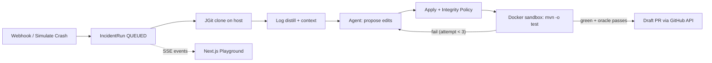

# Product Requirements Document (PRD): AutoHeal — Self-Healing CI/CD & Live Incident Playground

**Version:** 1.1 (revised from 1.0 — see Changelog at the bottom)

**Target Timeline:** 5 Weeks (Nov 23 – Dec 28) with an **MVP checkpoint at end of Week 3**

**Primary Tech Stack:** Java 21, Spring Boot 3.3+, Docker Engine (`docker-java`), JGit, PostgreSQL 16 (`pgvector`), Next.js (App Router)

**Deployment Target:** Vercel (Frontend) + a single Linux VM running `docker compose` (Spring Boot + PostgreSQL/pgvector + sandbox Docker Engine). Recommended: Oracle Cloud Ampere A1 (free tier, ARM64); alternative: Hetzner / AWS EC2.

---

## 1. Executive Summary & Product Vision

### 1.1 Problem Statement

When a CI/CD pipeline fails or a production microservice throws a critical exception, engineers spend significant time (commonly cited anecdotally as tens of minutes per incident) correlating stack traces, recent Git commits, and historical fixes before writing and verifying a patch. Existing LLM-based code assistants often propose plausible-looking but wrong fixes because they lack **deterministic runtime verification** against the project's own test suite.

### 1.2 Solution

**AutoHeal** is an autonomous incident triage and self-healing CI/CD system built in **Java 21 and Spring Boot 3**. It ingests failure webhooks, distills noisy stack traces into focused context, uses an LLM agent with tool-calling to propose a code patch (plus an optional new regression test), **verifies the patch inside an isolated, ephemeral, network-less Docker sandbox against the original failing test**, and opens a **GitHub Draft Pull Request** only after the full test suite passes and the patch satisfies a strict **Test Integrity Policy** (the agent cannot weaken, delete, or skip existing tests).

To eliminate setup friction for reviewers and recruiters, AutoHeal exposes a zero-setup **Live Incident Playground** web interface. Any visitor can trigger pre-configured failures with one click, watch the live Server-Sent Events (SSE) pipeline and Docker test output transition from `RED` to `GREEN`, inspect the generated diff, and click through to the live Draft PR on GitHub.

### 1.3 Goals vs. Non-Goals

| Goals (In Scope) | Non-Goals (Out of Scope) |
| --- | --- |
| End-to-end automated triage, patching, Docker verification, and GitHub Draft PR creation. | Auto-merging PRs into `main` without human approval. |
| Zero-setup web playground with 4 pre-loaded, **deterministically failing** Java/Spring bug scenarios. | Supporting arbitrary user-connected private GitHub repositories in v1. |
| Strict sandbox isolation (no network, CPU/memory/PID caps, non-root, dropped capabilities) for running untrusted AI patches. | Multi-language build runners (v1 targets Java 17/21 + Maven; Python/Node are future extensions). |
| Test Integrity Policy: the original failing test is the verification oracle; the agent may not modify existing tests or build config. | Fixing failures that require infra/network/DB changes (flaky infra, credentials, external services). |
| Quantitative evaluation harness on 25–30 curated, reproducible bugs, with ablations and an honest failure taxonomy. | Full enterprise SSO/OAuth multi-tenant billing. |

---

## 2. System Architecture & Tech Stack

### 2.1 High-Level Execution Flow

1. **Trigger:** Either a real GitHub Actions `workflow_run` (conclusion = `failure`) webhook OR a visitor clicking **"Simulate Crash"** in the Playground hits the Spring Boot API.
2. **Async Queueing:** Spring Boot creates an `IncidentRun` record (`QUEUED`), returns a `runId` immediately (`202 Accepted`), and dispatches the job to a **virtual-thread executor**. A `Semaphore(3)` bounds concurrent sandboxes; extra runs wait in `QUEUED` and report their queue position over SSE.
3. **Workspace Preparation:** The backend clones the target repo/branch at the failing `commit_sha` using **JGit on the host** into a per-run temp directory (`/var/autoheal/runs/{runId}`), owned by UID 1000. *(The sandbox has no network, so cloning never happens inside the container.)*
4. **Context Extraction:** The **Log Pre-Processor** obtains raw logs (webhook: downloads the run's logs zip via `GET /repos/{owner}/{repo}/actions/runs/{run_id}/logs`; playground: runs the baseline `mvn test` in the sandbox), strips Maven/JVM noise, extracts the root exception + `Caused by` chain, failing test(s), failing file/line numbers, recent commit diffs, and (optionally) queries `pgvector` for similar past incidents.
5. **Agentic Patch Loop (Max 3 Attempts):**
    * The **Triage Agent** (LLM via structured tool-calling) explores the local workspace with `read_file` / `search_code` / `list_files` and submits **search/replace edit blocks** via `propose_patch`.
    * The backend applies the edits to a fresh copy of the workspace, **validates them against the Test Integrity Policy**, and generates the canonical unified diff itself.
    * The **Docker Sandbox Runner** bind-mounts the workspace into an ephemeral hardened container and runs `mvn -o test`.
    * If edits fail to apply, violate policy, fail compilation, or fail tests, the distilled error is fed back to the agent for the next attempt.
6. **Verification & Handoff:** Once `mvn test` exits `0` **and** the originally failing test(s) are now reported as passing **and** total executed test count has not decreased, Spring Boot creates a fix branch via the GitHub API and opens a **Draft Pull Request** containing the root-cause analysis, test evidence, and latency/token metrics.
7. **Live Streaming:** Every state transition and Docker stdout line is persisted to `incident_events` and streamed to the frontend via **SSE**. Clients that connect late or reconnect receive history from the DB (via `Last-Event-ID`) and then live events.



### 2.2 Technology Stack

| Layer | Technology | Rationale |
| --- | --- | --- |
| **Backend Core** | Java 21 (Virtual Threads), Spring Boot 3.3+ | High concurrency for I/O-heavy LLM/GitHub/Docker calls; aligns with enterprise backend standards. |
| **Container Runtime** | Docker Engine + `docker-java` SDK | Programmatic creation, log streaming, resource capping, and teardown of ephemeral sandboxes. |
| **Git** | JGit (host-side clone/checkout) + GitHub REST API (branch/commit/PR) | No network needed in the sandbox; no shelling out to `git`. |
| **Patch Handling** | Search/replace edit blocks + `java-diff-utils` for canonical diffs | LLM-generated unified diffs frequently fail `git apply`; generating diffs server-side removes a whole failure class. |
| **LLM Integration** | Gemini API (e.g., Flash tier) via Spring AI or `WebClient`; provider behind an interface | Structured JSON output & tool-calling; low cost per run. |
| **Database & RAG** | PostgreSQL 16 + `pgvector` (in `docker compose` on the same VM) | Stores runs, events, LLM-call metrics, benchmark results, and incident embeddings. One fewer external provider; no free-tier cold starts. |
| **Rate Limiting** | Bucket4j (in-memory, single node) | Sufficient for a single-instance deployment. *Redis is a stretch goal (see §9).* |
| **Frontend Playground** | Next.js (App Router), Tailwind CSS, Monaco Diff Editor | Deployed on Vercel; browser connects **directly** to the backend for SSE (not proxied through Vercel functions, which have execution time limits). |
| **Infrastructure** | Single VM (Oracle Ampere A1 recommended), Nginx + Let's Encrypt, `docker compose` | Full root access for Docker Engine; no Docker-in-Docker. If ARM64, all images must be built for `linux/arm64`. |

---

## 3. Functional Requirements

### 3.1 Live Incident Playground (Frontend — Next.js)

* **FR-1.1 Scenario Selector:** Display 4 pre-loaded Java/Spring Boot bug scenarios stored in a public demo repository (`autoheal-demo-service`), each on its own branch/commit with a **deterministically failing** test:
    1. *Payment Service `NullPointerException`* (missing null check on optional discount payload).
    2. *Off-by-One Pagination / Pricing Bug* (boundary condition failure in unit test).
    3. *Concurrency Race Condition* (unsynchronized inventory decrement). **Requirement:** the test must fail on 100% of runs before the fix (e.g., `CountDownLatch`-coordinated threads with high iteration count) and pass on 100% after; verify with 20 consecutive runs. If this cannot be made deterministic, replace with a deterministic bug (e.g., `equals`/`hashCode` contract violation, `BigDecimal` rounding).
    4. *Repository Query Typo* (broken JPQL query). Tests use **H2 in-memory** (the sandbox has no network, so no Postgres/Testcontainers).
* **FR-1.2 Live vs. Replay Mode:**
    * **Live Run:** Triggers the real backend pipeline (rate-limited per IP).
    * **Instant Replay Mode:** Streams a real, previously recorded successful run from `incident_events` at 2x speed with zero LLM cost — so visitors can always experience the full flow even if rate limits or the budget breaker are hit. Replay runs are clearly labelled as replays.
* **FR-1.3 Real-Time Pipeline Visualizer:** A 5-stage progress tracker (`Incident Received` → `Log Distilled` → `Agent Patching` → `Sandbox Verification` → `Draft PR Opened`) updated via SSE, showing the attempt number (1–3) and queue position when queued.
* **FR-1.4 Live Terminal & Diff Viewer:**
    * Streaming terminal window showing real `mvn test` output turning from `BUILD FAILURE` (red) to `BUILD SUCCESS` (green).
    * Side-by-side syntax-highlighted diff of the AI's patch and any new JUnit test.
    * Direct clickable link to the newly created GitHub Draft PR.
* **FR-1.5 Benchmarks Tab:** Renders the latest evaluation report (§7) from `GET /api/v1/benchmarks/summary`.

### 3.2 Log Pre-Processor & Context Builder (Backend)

* **FR-2.1 Noise Reduction:** Parse raw Maven/Java output (up to 500KB). Strip Maven download/plugin chatter and framework frames (`org.springframework.*`, `java.base/*`, `jdk.internal.*`, `org.junit.*`, `sun.*`), while retaining: application-package frames, the full `Caused by:` chain messages, the failing test name + assertion message, and compiler errors with file/line. Collapse repeated frames. Target: ≥75% token reduction (measured with the LLM provider's token counter).
* **FR-2.2 Git Context:** From the local JGit clone, collect the last 3 commits' diffs touching files that appear in the distilled trace (cap total size).
* **FR-2.3 Historical RAG Lookup (optional per run, toggleable for ablation):**
    * Corpus = (a) a seeded set of ~30–50 hand-written Java incident write-ups (error signature → root cause → fix pattern), plus (b) **self-populating memory**: every verified fix stores its distilled signature + resolution summary.
    * Embed the distilled error signature and retrieve the top 2 most similar entries as few-shot context.
    * **Leakage guard:** during evaluation, exclude entries derived from the same bug/scenario ID.

### 3.3 Agentic Triage & Patch Loop (Backend)

* **FR-3.1 Structured Tool-Calling:** Provide the LLM with strictly typed tools operating on the **local workspace** (path-traversal protected, read-only):
    * `list_files(dir, glob)`
    * `read_file(path, start_line, end_line)` (max 400 lines per call)
    * `search_code(query, glob)` — ripgrep/`grep` over the local clone (not GitHub code search, which only indexes default branches and is rate-limited)
    * `propose_patch(edits: [{file, search, replace}], new_test_files: [{path, content}], root_cause_summary)` — `search` must match exactly once in the file; otherwise the edit is rejected with a precise error.
* **FR-3.2 Bounded Loop:** Maximum **3 patch attempts** per incident and a cap on tool calls per attempt (e.g., 15). On failure, append the distilled `mvn` failure (or apply/policy error) to the conversation and prompt the agent to self-correct.
* **FR-3.3 Token & Latency Accounting:** Record prompt tokens, completion tokens, estimated USD cost, and wall-clock duration for **every LLM call** (`llm_calls` table), aggregated per attempt and per run.
* **FR-3.4 Test Integrity Policy (verification oracle):** A patch is rejected before sandboxing if it:
    * modifies or deletes any existing file under `src/test/**`;
    * modifies `pom.xml`, `.mvn/**`, `mvnw`, CI config, or any file outside `src/main/**` (new files under `src/test/**` are allowed);
    * adds `@Disabled`, `assumeTrue(false)`, or similar skip mechanisms in new tests.

  A sandbox run counts as **verified** only if: exit code is `0`; the originally failing test(s) (parsed from Surefire XML reports in `target/surefire-reports`) are present and passing; and total executed tests ≥ baseline count.

### 3.4 Ephemeral Docker Sandbox Runner (Backend)

* **FR-4.1 Pre-warmed Runner Image:** Custom image `autoheal-maven-runner:java21` (multi-arch: `amd64` + `arm64`) with a Maven local repository baked at `/opt/m2`, owned by UID 1000. The cache is warmed **by running a real `mvn test` on the demo project during image build** (`dependency:go-offline` alone misses Surefire providers and some plugins). Target: `mvn -o test` in 5–15 seconds.
* **FR-4.2 Patch Application & Execution:** The patched per-run workspace is **bind-mounted** at `/workspace` (read-write). Command: `mvn -o -q -B -Dmaven.repo.local=/opt/m2 test` with `MAVEN_OPTS` and Surefire `argLine` heap caps so Maven + forked test JVM fit within the container memory limit.
* **FR-4.3 Guaranteed Cleanup:** `try/finally` container removal + per-run workspace deletion, plus a scheduled sweeper that force-removes any container labelled `autoheal=true` older than 90 seconds and orphan workspaces older than 1 hour.

### 3.5 GitHub Draft PR Integration (Backend)

* **FR-5.1 Branch & PR Creation:** On verified green build, create branch `autoheal/fix-{scenario}-{shortUuid}` and commit the changed files via the GitHub Git Data API (blobs → tree → commit → ref), then open a **Draft PR**. Auth: a fine-grained PAT scoped to the demo repo only (v1); GitHub App is a stretch goal.
* **FR-5.2 PR Body Template:** Root Cause Analysis; Summary of Changes; Verification Evidence (exit code, originally-failing test now passing, test counts before/after, execution time); Agent Metrics (attempts used, total latency, tokens, cost).
* **FR-5.3 Demo Repo Hygiene:** A daily scheduled job closes stale demo PRs and deletes `autoheal/*` branches older than 24 hours.

---

## 4. API Contracts & SSE Specification

### 4.1 REST Endpoints

```http
GET /api/v1/scenarios
```

*Returns the list of playground scenarios (id, title, description, language, whether a replay is available).*

```http
POST /api/v1/incidents/simulate
Content-Type: application/json

{
  "scenarioId": "payment-npe-01",
  "mode": "LIVE"
}
```

`mode` is `LIVE` or `REPLAY`. If the per-IP limit or daily budget breaker is hit, a `LIVE` request returns `429` with `{"suggestedMode": "REPLAY"}`.

**Response (`202 Accepted`):**

```json
{
  "runId": "3f1c9a2e-7b4d-4c1e-9a8f-2d6b5e0c1a77",
  "status": "QUEUED",
  "streamUrl": "/api/v1/incidents/3f1c9a2e-7b4d-4c1e-9a8f-2d6b5e0c1a77/stream"
}
```

```http
POST /api/v1/webhooks/github
X-Hub-Signature-256: sha256=...
X-GitHub-Event: workflow_run
```

*Validates the HMAC-SHA256 signature (constant-time compare), ignores events that aren't `workflow_run` with `action=completed` and `conclusion=failure`, de-duplicates by `X-GitHub-Delivery`, and triggers the same internal pipeline.*

```http
GET /api/v1/incidents/{runId}
```

*Returns full structured JSON of a completed or in-progress run (status, attempts, diff, root cause, PR URL, metrics).*

```http
GET /api/v1/benchmarks/summary
```

*Returns the latest evaluation report (fix rates, median/p90 time, mean cost, failure taxonomy, ablation results).*

### 4.2 Server-Sent Events (SSE) Stream Contract

**Endpoint:** `GET /api/v1/incidents/{runId}/stream` (`text/event-stream`)

* Each SSE message sets `id:` to `eventId` (monotonic per run). On reconnect, the browser sends `Last-Event-ID`; the server replays persisted events with a greater ID from `incident_events`, then continues live.
* Server sends a heartbeat comment (`: ping`) every 15s. Nginx config must set `proxy_buffering off` and a long `proxy_read_timeout` for this route.
* CORS allows only the Vercel frontend origin.

Each event payload follows a strict JSON envelope:

```json
{
  "eventId": 14,
  "timestamp": "2026-12-01T10:15:32Z",
  "stage": "SANDBOX_VERIFY",
  "type": "LOG_LINE",
  "payload": {
    "message": "[INFO] Tests run: 12, Failures: 0, Errors: 0, Skipped: 0",
    "attempt": 1
  }
}
```

* `stage` ∈ `QUEUED | INCIDENT_RECEIVED | LOG_DISTILLED | AGENT_PATCHING | SANDBOX_VERIFY | PR_OPENED`
* `type` ∈ `STAGE_UPDATE | LOG_LINE | TOOL_CALL | PATCH_PROPOSED | PATCH_REJECTED | ATTEMPT_RESULT | COMPLETED | FAILED`

---

## 5. Database Schema (PostgreSQL + `pgvector`)

```sql
CREATE EXTENSION IF NOT EXISTS vector;

CREATE TABLE incident_runs (
    id UUID PRIMARY KEY DEFAULT gen_random_uuid(),
    source VARCHAR(16) NOT NULL,          -- PLAYGROUND, WEBHOOK, EVAL, REPLAY
    scenario_id VARCHAR(64),
    repo_name VARCHAR(128) NOT NULL,
    commit_sha VARCHAR(64) NOT NULL,
    status VARCHAR(32) NOT NULL,          -- QUEUED, PREPARING, DISTILLING, PATCHING, VERIFYING, OPENING_PR, SUCCEEDED, FAILED
    failure_reason VARCHAR(64),           -- e.g. MAX_ATTEMPTS, PATCH_APPLY_ERROR, POLICY_VIOLATION, TIMEOUT, LLM_ERROR
    attempts_used INT DEFAULT 0,
    rag_enabled BOOLEAN DEFAULT TRUE,
    root_cause_summary TEXT,
    generated_diff TEXT,
    pr_url VARCHAR(255),
    total_prompt_tokens INT DEFAULT 0,
    total_completion_tokens INT DEFAULT 0,
    estimated_cost_usd NUMERIC(10, 6) DEFAULT 0,
    duration_ms BIGINT,
    created_at TIMESTAMPTZ DEFAULT NOW(),
    completed_at TIMESTAMPTZ
);

CREATE TABLE incident_attempts (
    id BIGSERIAL PRIMARY KEY,
    run_id UUID REFERENCES incident_runs(id) ON DELETE CASCADE,
    attempt_no INT NOT NULL,
    outcome VARCHAR(32) NOT NULL,         -- VERIFIED, APPLY_ERROR, POLICY_VIOLATION, COMPILE_ERROR, TEST_FAILURE, TIMEOUT
    diff TEXT,
    sandbox_exit_code INT,
    tests_run INT,
    tests_failed INT,
    sandbox_duration_ms BIGINT,
    created_at TIMESTAMPTZ DEFAULT NOW(),
    UNIQUE (run_id, attempt_no)
);

CREATE TABLE llm_calls (
    id BIGSERIAL PRIMARY KEY,
    run_id UUID REFERENCES incident_runs(id) ON DELETE CASCADE,
    attempt_no INT,
    model VARCHAR(64) NOT NULL,
    prompt_tokens INT NOT NULL,
    completion_tokens INT NOT NULL,
    cost_usd NUMERIC(10, 6) NOT NULL,
    latency_ms BIGINT NOT NULL,
    created_at TIMESTAMPTZ DEFAULT NOW()
);

CREATE TABLE incident_events (
    id BIGSERIAL PRIMARY KEY,
    run_id UUID REFERENCES incident_runs(id) ON DELETE CASCADE,
    event_seq INT NOT NULL,               -- = SSE eventId, monotonic per run
    stage VARCHAR(32) NOT NULL,
    event_type VARCHAR(32) NOT NULL,
    payload JSONB NOT NULL,
    created_at TIMESTAMPTZ DEFAULT NOW(),
    UNIQUE (run_id, event_seq)
);

CREATE TABLE incident_memory (
    id UUID PRIMARY KEY DEFAULT gen_random_uuid(),
    source VARCHAR(16) NOT NULL,          -- SEED, VERIFIED_RUN
    origin_bug_id VARCHAR(64),            -- used by the eval leakage guard
    error_signature TEXT NOT NULL,
    resolution_summary TEXT NOT NULL,
    embedding vector(768),                -- must match embedding model output dimensionality
    created_at TIMESTAMPTZ DEFAULT NOW()
);

-- HNSW works on empty/small tables (ivfflat needs representative data at build time).
CREATE INDEX idx_incident_memory_embedding
ON incident_memory USING hnsw (embedding vector_cosine_ops);

CREATE TABLE benchmark_reports (
    id BIGSERIAL PRIMARY KEY,
    model VARCHAR(64) NOT NULL,
    config JSONB NOT NULL,                -- e.g. {"rag": true, "maxAttempts": 3}
    results JSONB NOT NULL,               -- per-bug outcomes + aggregates
    created_at TIMESTAMPTZ DEFAULT NOW()
);
```

### In-Memory Keys (Bucket4j / Caffeine)

* Per-IP bucket: max 3 live runs per hour per IP (IP taken from `X-Forwarded-For` set by Nginx only).
* Daily spend counter (persisted by summing `llm_calls.cost_usd` for today on startup).

---

## 6. Non-Functional Requirements & Security Guardrails

### 6.1 Sandbox Security (Critical)

Running LLM-generated code is equivalent to running untrusted code. Every container spawned by `docker-java` **must** enforce:

* `--network=none` (no internet or cloud metadata-service access).
* `--memory=768m --memory-swap=768m` and `--cpus=1.0`.
* `--pids-limit=256` (memory/CPU caps alone do **not** stop fork bombs).
* `--cap-drop=ALL` and `--security-opt=no-new-privileges`.
* Non-root user `1000:1000`.
* `--read-only` root filesystem with `tmpfs` at `/tmp`; the only writable host path is the per-run `/workspace` bind mount. *(Week-1 spike must confirm offline Maven works with a read-only `/opt/m2`; if not, document the trade-off and drop `--read-only` while keeping the other controls.)*
* Hard execution timeout of **60 seconds** (container killed on timeout; attempt marked `TIMEOUT`).
* Label `autoheal=true` on every container for the sweeper.

**Host-level notes:** The backend holds access to the Docker socket, which is effectively root on the VM. Keep the VM single-purpose, keep secrets (LLM key, GitHub PAT, webhook secret) in environment variables/`.env` excluded from Git, never mount secrets into sandboxes, and block the cloud metadata IP at the host firewall as defence in depth.

### 6.2 Cost & Abuse Protection

* Per-IP rate limiting (`429 Too Many Requests` with a suggestion to use **Replay Mode**).
* Global daily circuit breaker: if total daily LLM spend exceeds a configurable threshold (e.g., `$2.00/day`), all Playground `LIVE` requests degrade to **Replay Mode** with a transparent banner.
* Global cap on queued runs (e.g., 10); beyond that, return `503` suggesting Replay Mode.

### 6.3 Performance Targets

* **SSE First Event Latency:** < 300ms from `POST /simulate` returning to first `STAGE_UPDATE` event received.
* **End-to-End Resolution Time:** Target median < 60s for a 1-attempt fix (clone + baseline run + LLM + verified run + PR). Pre-warmed Maven cache is mandatory.
* **Concurrent Runs:** At least 3 concurrent sandboxes on the target VM; additional requests queue gracefully with position updates.

---

## 7. Evaluation Harness & Resume Metrics

Build a CLI runner (`autoheal-eval`) that executes the **same pipeline** (minus PR creation) against a benchmark set and writes a Markdown + JSON report (also stored in `benchmark_reports`).

**Benchmark set (25–30 bugs):**

* **Primary:** curated, reproducible bugs on Java 17/21 + Maven. Sources: real bug-fix commits from open-source Java/Spring projects re-created in small modules, plus custom bugs. Each bug has: buggy commit, a failing test (oracle), and the developer's reference fix (for analysis only, never shown to the agent).
* **Optional external credibility:** a small subset of Defects4J or GitBug-Java. Note: Defects4J requires its own framework and JDK 8/11, so it needs a **separate runner image**. Defects4J is also likely present in LLM training data (contamination), so report it separately.
* Bugs are **not** the 4 playground scenarios. Report bug categories (NPE, boundary, concurrency, API misuse, query, logic).

| Metric | Definition | Initial Target |
| --- | --- | --- |
| **Fix Rate @1 attempt** | % of bugs verified (per §3.3 FR-3.4) on the first patch attempt. | Report actual |
| **Fix Rate @3 attempts** | % of bugs verified within the 3-attempt feedback loop. *(Not "pass@k", which in the literature means k independent samples.)* | Report actual |
| **Log Compression Ratio** | 1 − (distilled tokens / raw tokens). | ≥ 75% |
| **Time to Verified Patch** | Median and p90 wall-clock time from trigger to verified green build. | Median < 60s |
| **Mean Cost per Verified Fix** | Total LLM spend / number of verified fixes. | < $0.05 |
| **Patch Correctness (manual)** | % of verified patches judged semantically equivalent to the reference fix (catches overfitting to tests). | Report actual |

**Required analyses:**

* **Ablations:** RAG on vs. off; feedback loop (3 attempts) vs. single shot; log distillation on vs. raw logs.
* **Failure taxonomy:** count failures by `failure_reason` / attempt outcome (apply error, policy violation, compile error, wrong fix, timeout).
* **Repeatability:** run the suite 3 times and report mean ± spread (LLM outputs are non-deterministic).

---

## 8. 5-Week Implementation Roadmap

* **Week 1: De-risk the core (CLI only, no UI/DB)**
    * Create `autoheal-demo-service` with 4 bug branches; confirm each test fails/passes deterministically (20 runs).
    * Build the multi-arch pre-warmed runner image; implement `DockerSandboxService` with all §6.1 flags, live stdout streaming, timeout, and cleanup. **Spike:** read-only rootfs + offline Maven.
    * JGit clone into per-run workspace; Surefire XML report parsing.
* **Week 2: Agent loop + GitHub (still CLI)**
    * Log distiller (with token-count measurement), local tools (`list_files`, `read_file`, `search_code`), search/replace patch applier + diff generation, Test Integrity Policy, 3-attempt loop.
    * GitHub client: create branch/commit/Draft PR. Milestone: `autoheal fix --scenario payment-npe-01` opens a real Draft PR.
* **Week 3: Spring Boot service, persistence, SSE, deploy → MVP checkpoint**
    * Wrap pipeline in Spring Boot: REST, async executor + semaphore, PostgreSQL schema (Flyway), `incident_events` persistence, SSE with `Last-Event-ID` replay, Replay Mode, rate limiting, budget breaker.
    * Deploy backend + Postgres via `docker compose` on the VM (Nginx + Let's Encrypt). **MVP = all 4 scenarios work live + replay via API.**
* **Week 4: Playground UI + webhook + RAG**
    * Next.js UI (scenario cards, 5-stage visualizer, live terminal, Monaco diff, PR link, benchmarks tab) on Vercel.
    * GitHub `workflow_run` webhook path (HMAC, log zip download, de-dup).
    * `incident_memory` seed corpus + self-populating memory + leakage guard.
* **Week 5: Evaluation, hardening & polish**
    * Curate the 25–30 bug set (start collecting in Week 2 in parallel), run eval + ablations ×3, write failure taxonomy.
    * README: architecture diagram, benchmark table, security model, `DECISIONS.md` (ADRs), 60–90s demo video/GIF at the top.

---

## 9. Stretch Goals (post-MVP)

* Redis for distributed rate limiting + SSE pub/sub when running multiple backend instances.
* GitHub App installation (instead of PAT) to support other repos.
* gVisor (`runsc`) runtime for stronger sandbox isolation.
* Python/pytest runner image.
* OpenTelemetry tracing for each pipeline stage.

## 10. Risks

| Risk | Mitigation |
| --- | --- |
| Agent "passes" by gaming tests | Test Integrity Policy (FR-3.4) + manual patch-correctness metric. |
| Flaky scenario tests | Determinism requirement in FR-1.1, 20-run check. |
| Offline Maven misses artifacts | Warm cache via real `mvn test` at image build; pin all plugin versions in demo `pom.xml`. |
| VM down when a recruiter visits | Replay Mode + demo video in README; uptime monitor. |
| LLM cost overrun | Per-IP limits, daily breaker, Flash-tier model. |
| Timeline slip | MVP checkpoint at end of Week 3; RAG/webhook/eval scope can shrink without breaking the demo. |

---

## Changelog (v1.0 → v1.1)

* Fixed sandbox contradiction: repo is cloned on host (JGit) and bind-mounted; container stays `--network=none`.
* Fixed `.m2` location/ownership mismatch with non-root user; cache warmed via real `mvn test`.
* Added sandbox controls: `--pids-limit`, `--cap-drop=ALL`, `no-new-privileges`; Docker-socket risk noted.
* Added **Test Integrity Policy** — original failing test is the oracle; agent can't edit existing tests/build files.
* Replaced LLM-written unified diffs with search/replace edits + server-side diff generation.
* `search_codebase` now runs locally (GitHub code search only indexes default branch).
* Webhook flow downloads Actions logs (not present in the `workflow_run` payload).
* RAG: defined corpus (seed + self-populating memory), eval leakage guard, ablation; `ivfflat` → `hnsw`.
* Schema: added `incident_attempts`, `llm_calls`, `benchmark_reports`; aligned status enum with stages; run IDs are UUIDs.
* SSE: `Last-Event-ID` resume, heartbeats, Nginx buffering note, direct browser→backend connection.
* Infra simplified to one VM with `docker compose` (Postgres included); Redis moved to stretch goals.
* Race-condition scenario must be deterministic; JPQL scenario uses H2.
* Eval: renamed pass@k → Fix Rate @N attempts; Defects4J caveats; ablations, repeatability, failure taxonomy, manual correctness; targets reported as actuals.
* Roadmap re-ordered to de-risk sandbox + agent first (CLI), with an MVP checkpoint at end of Week 3.
