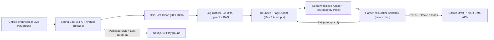

<div align="center">

# AutoHeal

**Autonomous CI/CD Incident Triage & Self-Healing System with Deterministic Docker Verification**

[](https://openjdk.org/projects/jdk/21/)
[](https://spring.io/projects/spring-boot)
[](https://nextjs.org/)
[](https://github.com/pgvector/pgvector)
[](https://docs.docker.com/)
[](#quality-gates)

<p>
  <a href="#architecture">Architecture</a> •
  <a href="#security--verification-invariants">Security Model</a> •
  <a href="#live-incident-playground">Playground</a> •
  <a href="#local-quickstart">Quickstart</a> •
  <a href="#evaluation-harness-autoheal-eval">Benchmarks</a> •
  <a href="#production-deployment">Deploy</a>
</p>

</div>

---

## Why AutoHeal?

LLM code assistants routinely generate plausible-looking patches that fail to compile, miss edge cases, or silently weaken tests. **AutoHeal** closes the loop with **deterministic runtime verification**:

- **Zero-Trust Execution:** Every AI-proposed patch is applied server-side via exact search/replace edits and executed inside an ephemeral, `--network=none`, `--read-only`, non-root Docker sandbox (`mvn -o test`).
- **Test Integrity Policy (Verification Oracle):** Existing tests and build files (`pom.xml`, `.mvn/**`, `mvnw`) are immutable. A patch is verified **only** when Maven exits `0`, the originally failing oracle test(s) pass in Surefire XML, and the total executed test count does not decrease.
- **Zero-Setup Live Playground:** Visitors can trigger 4 deterministic Java/Spring bug scenarios with one click, watch live `RED → GREEN` Maven output over persisted SSE (`Last-Event-ID`), inspect side-by-side Monaco diffs, and open the generated GitHub Draft PR—or switch to **Instant Replay Mode** at `$0` LLM cost.
- **Real GitHub Actions Webhook Support:** Point any Java/Maven repository's `workflow_run` webhook at `/api/v1/webhooks/github` (constant-time HMAC-SHA256 verified) to automatically triage real CI failures and open Draft PRs.

---

## Architecture



### Hexagonal Package Layering *(Enforced by ArchUnit)*

```text
com.autoheal.api      ──▶  com.autoheal.service  ──▶  com.autoheal.domain
  (REST, SSE, CLI)          (Orchestration, RAG,        (Pure Java 21 records
                             Policy, Eval, Cron)         & port interfaces)
                                     ▲
                                     │ implements
                           com.autoheal.infra
                      (Docker, JGit, Gemini, GitHub,
                       Spring JdbcClient + pgvector)
```

| Layer | Responsibility | Architectural Guarantee |
| --- | --- | --- |
| **`domain`** | Immutable records & port interfaces (`SandboxRunner`, `WorkspaceManager`, `LlmClient`, `GitHubPrClient`, repositories) | Zero Spring, Docker, Git, or HTTP imports |
| **`service`** | Log distillation, Test Integrity Policy, bounded agent loop, `pgvector` RAG, Bucket4j limits, eval harness, sweepers | ≥ 80% JaCoCo line coverage |
| **`infra`** | `DockerSandboxRunner`, `JGitWorkspaceManager`, `GeminiLlmClient`, GitHub REST clients, `JdbcClient` + Flyway | Never depends on `api` |
| **`api`** | Thin controllers, `SseEmitter` streaming, webhook verifier endpoint, `@RestControllerAdvice`, CLI eval runner | Never bypasses `service` to `infra` |

---

## Security & Verification Invariants

> [!IMPORTANT]
> Running LLM-generated patches is equivalent to executing untrusted code. Every control below is enforced in production code and covered by automated tests.

| Control | Implementation |
| --- | --- |
| **Hardened Sandbox (`PRD §6.1`)** | `--network=none`, `--memory=768m`, `--memory-swap=768m`, `--cpus=1.0`, `--pids-limit=256`, `--cap-drop=ALL`, `no-new-privileges`, `--read-only` rootfs + `tmpfs /tmp`, non-root UID `1000:1000`, 60s hard timeout, `autoheal=true` sweeper label, zero host secrets in env. |
| **Test Integrity Policy (`FR-3.4`)** | Only `src/main/**` edits and *new* test files allowed; existing tests, `pom.xml`, `.mvn/**`, and `mvnw` are immutable; `@Disabled` / `assumeTrue(false)` rejected; Surefire XML oracle must pass with `executedTests >= baseline`. |
| **Path-Traversal Guard (`FR-3.1`)** | `WorkspacePathResolver` canonicalizes paths and rejects `..`, absolute paths, and symlinks escaping the workspace root across `list_files`, `read_file`, `search_code`, and `PatchApplier`. |
| **Webhook Security (`PRD §4.1`)** | Constant-time `MessageDigest.isEqual` HMAC-SHA256 verification on raw payload bytes, `X-GitHub-Delivery` LRU de-duplication, and 512 KB zip-bomb-capped Actions log extraction. |
| **Abuse & Cost Protection (`PRD §6.2`)** | Bucket4j per-IP rate limiting (`3 live runs/hr`), global daily LLM spend circuit breaker (`$2.00/day`), and `Semaphore(3)` concurrency bulkhead + queue cap (`10`). |
| **Eval Leakage Guard (`FR-2.3`)** | `pgvector` HNSW cosine search (`<=>`) excludes `incident_memory` rows matching the active `origin_bug_id`. |
| **Demo Repo Hygiene (`FR-5.3`)** | Daily `@Scheduled` job closes stale PRs & deletes branches older than 24h; both service and REST adapter refuse to delete any branch not prefixed with `autoheal/`. |

---

## Live Incident Playground

Four deterministic Java 21 / Spring Boot bug scenarios live in [`demo-service/`](demo-service/):

| Scenario ID | Bug Class | Description | Verification Oracle |
| --- | --- | --- | --- |
| `payment-npe-01` | `NullPointerException` | Missing null guard on optional discount payload | `PaymentServiceTest` |
| `pagination-offbyone-02` | Boundary / Off-by-One | Page slice upper-bound off-by-one defect | `PaginationServiceTest` |
| `inventory-race-03` | Concurrency Race | Unsynchronized stock decrement (`CountDownLatch`-deterministic) | `InventoryServiceTest` |
| `order-jpql-04` | Repository Query Typo | Broken Spring Data JPA JPQL query against in-memory H2 | `OrderRepositoryTest` |

### Key Endpoints

| Method | Endpoint | Purpose |
| --- | --- | --- |
| `GET` | `/api/v1/scenarios` | List all 4 playground scenarios + live `replayAvailable` flags |
| `POST` | `/api/v1/incidents/simulate` | Trigger a `LIVE` or `REPLAY` run (`202 Accepted` with `runId` & `streamUrl`) |
| `GET` | `/api/v1/incidents/{runId}` | Full run state, attempts, unified diff, root cause, PR URL, token/cost metrics |
| `GET` | `/api/v1/incidents/{runId}/stream` | Persisted SSE stream (`text/event-stream`) with `Last-Event-ID` resume & 15s heartbeats |
| `POST` | `/api/v1/webhooks/github` | GitHub Actions `workflow_run` failure webhook receiver |
| `GET` | `/api/v1/benchmarks/summary` | Latest evaluation report (fix rates, ablations, latency, cost, failure taxonomy) |
| `GET` | `/actuator/health` | Service health check |

---

## Local Quickstart

**Prerequisites:** Java 21+, Maven 3.9+, Node.js 20+, Docker Desktop (running).

```bash
cp .env.example .env   # add GEMINI_API_KEY and set FRONTEND_ORIGIN=http://localhost:3000

./autoheal up          # starts Postgres, Backend (:8080), and Frontend (:3000)
./autoheal status      # check health of all services
./autoheal logs        # tail backend & frontend logs
./autoheal down        # cleanly stops everything (keeps DB data)
```

<details>
<summary><strong>Connecting Your Own GitHub Repository (Webhook Setup)</strong></summary>

1. In your Java/Maven GitHub repository, open **Settings → Webhooks → Add webhook**:
   - **Payload URL:** `https://<your-autoheal-host>/api/v1/webhooks/github`
   - **Content type:** `application/json`
   - **Secret:** match `GITHUB_WEBHOOK_SECRET` in `.env`
   - **Events:** select **Workflow runs** (`workflow_run`)
2. Configure `GITHUB_TOKEN` (fine-grained PAT with **Contents: Read & Write**, **Pull requests: Read & Write**, and **Actions: Read**) and `AUTOHEAL_PR_CREATION_ENABLED=true`.
3. Because sandboxes run with `--network=none`, pre-warm your project's Maven dependencies into `autoheal-maven-runner:java21` (`/opt/m2`).

</details>

---

## Evaluation Harness (`autoheal-eval`)

Run the real healing pipeline (without PR creation) across all 4 PRD §7 ablations (**Full**, **No RAG**, **Single-Shot**, **Raw Logs**) with `repeatCount` repeatability, write Markdown + JSON reports, and persist directly to `benchmark_reports` for the UI's **Benchmarks** tab:

```bash
java -jar backend/target/autoheal-backend-0.1.0-SNAPSHOT.jar \
  --spring.main.web-application-type=none \
  --autoheal.eval.enabled=true \
  --autoheal.eval.corpus=eval-corpus/bugs.example.json \
  --autoheal.eval.output-dir=eval-results \
  --autoheal.eval.repeats=3
```

---

## Production Deployment

<details>
<summary><strong>Single Linux VM (Docker Compose + Nginx SSE) + Vercel Frontend</strong></summary>

1. **Provision VM** (e.g., Oracle Cloud Ampere A1 / Hetzner / EC2) with Docker Engine + Docker Compose.
2. **Configure environment:** copy `.env.example` → `.env` and fill in `DATABASE_PASSWORD`, `GEMINI_API_KEY`, `GITHUB_TOKEN`, `GITHUB_WEBHOOK_SECRET`, `DEMO_REPO_URI`, `DEMO_REPO_NAME`, `FRONTEND_ORIGIN`, and `DOCKER_GID`.
3. **Prepare sandbox image & workspace directory:**
   ```bash
   docker build -t autoheal-maven-runner:java21 -f sandbox/Dockerfile .
   sudo mkdir -p /var/autoheal/runs && sudo chown 1000:1000 /var/autoheal/runs
   ```
4. **Launch stack:**
   ```bash
   docker compose -f docker-compose.prod.yml up -d --build
   ```
   Nginx ([`infra/nginx/autoheal.conf`](infra/nginx/autoheal.conf)) sets `proxy_buffering off` on `/api/v1/incidents/*/stream` and overwrites `X-Forwarded-For` with `$remote_addr`.
5. **Deploy Frontend to Vercel:** point `frontend/` at `NEXT_PUBLIC_API_BASE_URL=https://<your-vm-domain>` so browser SSE connects directly to the VM backend.

</details>

---

## Quality Gates

| Suite | Command | Status |
| --- | --- | --- |
| **Backend Tests + Testcontainers + Docker Sandbox** | `cd backend && mvn -B verify` | `130/130` passing |
| **Formatting & Static Analysis** | Spotless (`google-java-format`) + Error Prone | `166/166` clean, `0` warnings |
| **Architecture & Coverage** | ArchUnit (`4/4`) + JaCoCo (`≥ 80%` on `service`/`domain`) | All checks met |
| **Frontend Typecheck, Lint & E2E** | `cd frontend && npm run typecheck && npm run lint && npx playwright test --project=smoke` | `0` errors/warnings, `2/2` Playwright passing |

---

## Engineering Docs

| Document | Purpose |
| --- | --- |
| [`PRD.md`](PRD.md) | Product Requirements v1.1 — functional requirements, API/SSE contracts, PostgreSQL schema, evaluation spec |
| [`DECISIONS.md`](DECISIONS.md) | Architecture Decision Records (`ADR-001` through `ADR-005`) |
| [`docs/LEARNING.md`](docs/LEARNING.md) | Per-slice Java/Spring/Docker concepts, trade-offs, and interview Q&As (Slices 1–21) |
