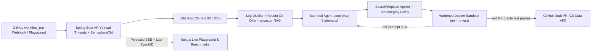

# AutoHeal — Autonomous CI/CD Incident Triage & Self-Healing System

**AutoHeal** is a Java 21 / Spring Boot 3.4 autonomous CI/CD self-healing system with a zero-setup **Live Incident Playground** (Next.js + Monaco Diff Editor). When a CI build fails—via a real GitHub Actions `workflow_run` webhook or a one-click Playground trigger—AutoHeal clones the failing branch on the host, distills noisy Maven/JVM stack traces, runs a bounded LLM tool-calling agent to propose search/replace patches, **deterministically verifies every patch inside a hardened `--network=none` Docker sandbox against the original failing test**, and opens a **GitHub Draft Pull Request** only after the build turns green and passes a strict **Test Integrity Policy**.

---

## Architecture



### Hexagonal Layering (Enforced by ArchUnit)
`com.autoheal.api` → `com.autoheal.service` → `com.autoheal.domain` / `com.autoheal.infra`

- **`domain`**: Pure immutable Java 21 `record` models and port interfaces (`SandboxRunner`, `WorkspaceManager`, `LlmClient`, `GitHubPrClient`, `IncidentRepository`, `IncidentMemoryRepository`, `BenchmarkReportRepository`). Zero Spring/Docker/Git/HTTP imports.
- **`service`**: Business logic, orchestration, log distillation, Test Integrity Policy, bounded agent loop, `pgvector` RAG service, Bucket4j abuse protection, evaluation harness, and scheduled sweepers/hygiene.
- **`infra`**: Concrete adapters (`DockerSandboxRunner`, `JGitWorkspaceManager`, `GeminiLlmClient`, `GeminiEmbeddingClient`, `GitHubRestPrClient`, `GitHubRestActionsLogClient`, `GitHubRestRepoHygieneClient`, Spring `JdbcClient` PostgreSQL + `pgvector` repositories).
- **`api`**: Thin REST controllers, SSE streaming (`SseEmitter` with `: ping` heartbeats and `Last-Event-ID` DB replay), webhook receiver, global `@RestControllerAdvice`, and conditional CLI eval runner.

---

## Security & Verification Invariants

| Invariant | Enforcement |
| --- | --- |
| **Hardened Sandbox (`PRD §6.1`)** | `--network=none`, `--memory=768m`, `--memory-swap=768m`, `--cpus=1.0`, `--pids-limit=256`, `--cap-drop=ALL`, `no-new-privileges`, `--read-only` rootfs + `tmpfs /tmp`, non-root UID `1000:1000`, 60s hard timeout, `autoheal=true` sweeper label, zero host secrets in env. |
| **Test Integrity Policy (`FR-3.4`)** | Patches may only modify `src/main/**` and add new tests; existing tests and build files (`pom.xml`, `.mvn/**`, `mvnw`) are immutable; skip annotations (`@Disabled`, `assumeTrue(false)`) are rejected. Verified = exit code `0` + original failing oracle test(s) passing in Surefire XML + executed test count not reduced. |
| **Path-Traversal Protection (`FR-3.1`)** | All agent workspace tools (`list_files`, `read_file`, `search_code`) and `PatchApplier` canonicalize paths and reject `..`, absolute paths, and symlinks escaping the workspace root. |
| **Webhook Integrity (`PRD §4.1`)** | Constant-time `MessageDigest.isEqual` HMAC-SHA256 verification on raw request bytes, `X-GitHub-Delivery` LRU de-duplication, and 512 KB bounded zip-bomb-safe Actions log extraction. |
| **Eval Leakage Guard (`FR-2.3`)** | `pgvector` cosine similarity search excludes `incident_memory` entries matching the active `origin_bug_id`. |
| **Demo Hygiene Guard (`FR-5.3`)** | Daily scheduled job closes stale PRs and deletes branches older than 24 hours; both service and REST adapter refuse to delete any branch not prefixed with `autoheal/`. |

---

## Tech Stack

- **Backend:** Java 21 (Virtual Threads), Spring Boot 3.4.3, Maven, `docker-java` (zerodep), JGit, `java-diff-utils`, Flyway, Spring `JdbcClient`, PostgreSQL 16 + `pgvector`, Bucket4j.
- **Frontend:** Next.js 15 (App Router), TypeScript (strict), Tailwind CSS v4, Monaco Diff Editor, Playwright E2E.
- **Quality Gates:** Spotless (`google-java-format`), Error Prone, ArchUnit, JaCoCo (≥ 80% line coverage on `service`/`domain`), Testcontainers (`pgvector:pg16`), `tsc --noEmit`, ESLint (`--max-warnings 0`).

---

## Pre-Loaded Demo Scenarios (`demo-service/`)

1. **`payment-npe-01`** — Payment service `NullPointerException` on optional discount payload.
2. **`pagination-offbyone-02`** — Off-by-one boundary condition in pagination logic.
3. **`inventory-race-03`** — Deterministic concurrency race condition (`CountDownLatch`-coordinated).
4. **`order-jpql-04`** — Broken Spring Data JPA JPQL query verified against in-memory H2.

Every scenario supports **Live Mode** (rate-limited per IP + daily LLM spend circuit breaker) and **Instant Replay Mode** (streams a recorded real run from `incident_events` at `$0` LLM cost).

---

## Local Quickstart

### Prerequisites
- Java 21+, Maven 3.9+, Node.js 20+, Docker Desktop (running)

### 1. Build the Pre-Warmed Sandbox Image
```bash
docker build -t autoheal-maven-runner:java21 -f sandbox/Dockerfile .
```

### 2. Start PostgreSQL 16 + `pgvector`
```bash
docker compose up -d
```

### 3. Run the Backend & Verify Quality Gates
```bash
cd backend
mvn -B verify
# Run locally (set GEMINI_API_KEY, DEMO_REPO_URI, and optionally GITHUB_TOKEN)
mvn spring-boot:run
```

### 4. Run the Frontend Playground
```bash
cd frontend
npm ci
npm run dev
# Frontend quality gates:
npm run typecheck && npm run lint && npx playwright test --project=smoke
```

---

## Connecting Your Own GitHub Repository

1. In your Java/Maven GitHub repository, go to **Settings → Webhooks → Add webhook**:
   - **Payload URL:** `https://<your-autoheal-host>/api/v1/webhooks/github`
   - **Content type:** `application/json`
   - **Secret:** match `GITHUB_WEBHOOK_SECRET` in `.env`
   - **Events:** select **Workflow runs** (`workflow_run`)
2. Set `GITHUB_TOKEN` (fine-grained PAT with `Contents: R/W`, `Pull requests: R/W`, `Actions: Read`) and `AUTOHEAL_PR_CREATION_ENABLED=true`.
3. Ensure your repository's Maven dependencies are cached in `autoheal-maven-runner:java21` (`/opt/m2`) since sandboxes run offline (`--network=none`).

---

## Evaluation Harness (`autoheal-eval`, `PRD §7`)

Run the evaluation harness (full pipeline minus PR creation) across all 4 ablations (`Full`, `No RAG`, `Single-shot`, `Raw logs`) and persist results directly to `benchmark_reports` (rendered in the UI's **Benchmarks** tab):

```bash
java -jar backend/target/autoheal-backend-0.1.0-SNAPSHOT.jar \
  --spring.main.web-application-type=none \
  --autoheal.eval.enabled=true \
  --autoheal.eval.corpus=eval-corpus/bugs.example.json \
  --autoheal.eval.output-dir=eval-results \
  --autoheal.eval.repeats=3
```

Outputs `eval-results/benchmark-report.md` and `eval-results/benchmark-report.json`.

---

## Production Deployment (Single VM + Vercel)

1. **Backend VM (Linux + Docker Engine):**
   - Copy `.env.example` to `.env` and fill in `DATABASE_PASSWORD`, `GEMINI_API_KEY`, `GITHUB_TOKEN`, `GITHUB_WEBHOOK_SECRET`, `DEMO_REPO_URI`, `DEMO_REPO_NAME`, `FRONTEND_ORIGIN`, and `DOCKER_GID`.
   - Build `autoheal-maven-runner:java21` for the host architecture (`linux/arm64` or `linux/amd64`).
   - Run `mkdir -p /var/autoheal/runs && sudo chown 1000:1000 /var/autoheal/runs`.
   - Launch the stack: `docker compose -f docker-compose.prod.yml up -d --build`.
   - Nginx (`infra/nginx/autoheal.conf`) disables buffering (`proxy_buffering off`) on `/api/v1/incidents/*/stream` and overwrites `X-Forwarded-For` with `$remote_addr`.
2. **Frontend (Vercel):**
   - Deploy `frontend/` with `NEXT_PUBLIC_API_BASE_URL=https://<your-vm-domain>`. Browser SSE connects directly to the VM backend (never proxied through serverless functions).

---

## Further Documentation

- [`PRD.md`](PRD.md) — Full product requirements, API/SSE contracts, DB schema, and evaluation methodology.
- [`DECISIONS.md`](DECISIONS.md) — Architecture Decision Records (ADRs 001–005).
- [`docs/LEARNING.md`](docs/LEARNING.md) — Per-slice Java/Spring/Docker concepts and interview Q&As (Slices 1–21).
